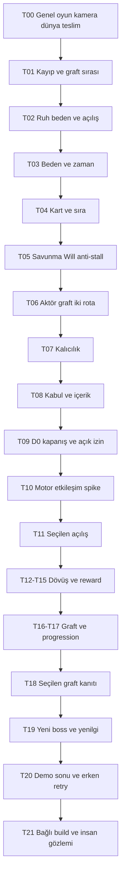

# D0'dan oynanabilir örneğe çalışma planı

Tarih: 2026-09-06; karar konsolidasyonu: 2026-10-26. Durum: **PAPER ONLY — incelemeye açık iş planı; D0 kapanmadı,
engine/runtime izni verilmedi.** Bu belge koordinasyon ve kabul sözleşmesidir;
altıncı tasarım otoritesi değildir. Kararlar beş yaşayan belgeye işlenir.

## Güncel son soru yüzeyi ve koşullu uygulama yönlendirmesi

[Z01-Z55 seçim defteri, gerekçeli istisnalar ve kalan D0 işi](DEMO_D0_CONSOLIDATED_PLAN_2026-10-26.md).
Owner Z01-Z10=A yanıtladı ve soru turunu durdurarak Z11-Z55'i mevcut kurallara göre
optimize etme yetkisi verdi. Z14/Z15/Z22/Z50=B, diğer kalan kartlar A olarak
dosyalandı. Z48=A bu delegasyonla önceki F59=B inceleme modelini D0 fixture işi
için değiştirir. M01-M03 olguları, exact P01-P12 tabloları ve sonlanma kanıtı
hazır değildir; karar seçimi ticket kapanışı veya oynanış kanıtı değildir.
Koşullu demo üretme talebi korunur; bu tur engine/runtime başlatılmadı.

## Son owner revizyonu — O1/S1 ve Boneatour, 2026-09-08

O1/S1 seçildi. Boneatour: iskelet minotor, güçlü statlar, horn Charge yalnız
hücum sırasında refleksif Parry ile durur; stun sonraki Preparation/Main'i kaldırır,
savunma kalır. BP1-BP3 ve hazırlıkta iptal + Red/Evade önerisi seçili değil.
I1/üç araç/melez saat ve pause/erişim yönleri kabul; G2, PA1/PA2, D1/D2
karşılaştırma kapsamı; H3 gerçek cihaz adaylarına eklendi.
[F yanıtları ve iki ek Charge/stun cevabı](DEMO_ANSWER_REVIEW_2026-09-08.md).
Q25 exact ölüm ve Q15 kaynak/Will/kaçınma hâlâ açık. F37 yanıtlanmadı.
Ticket kapanışı veya runtime izni verilmedi.

## Gerçekte ne var?

İncelenen başlangıç commit'i: `2e82194c02b616965accc1197742b411f8604917`.
Aktif ağaçta beş yaşayan tasarım belgesi, DWF/WNR ve kart araştırmaları, eski Python
simülatörü ve ayrı H1/görsel lab dosyaları var. Yeni Underground City engine projesi
ve oynanabilir ürün build'i bulunmadı. Bu inceleme eski runtime'ın doğruluğunu yeniden
onaylamaz. [Denetim ve taze kontroller](../../research/skill_audit_2026-09-06.md).

Başlangıç sorunu fikir kıtlığı değil: onaylı yönler arasındaki sayısal, zamansal ve
oyuncu akışı bağlantıları henüz tek çalıştırılabilir sözleşme oluşturmuyor.
Skill kaynak önceliği de daha eski hedefi taşıyordu; bu çalışma onu düzeltiyor.

## 2026-09-08 yanıtların işlenmesi

[60 cevabın kaydı, araştırma ve birbirine bağlı seçenekler](DEMO_ANSWER_REVIEW_2026-09-08.md).
Yeni deneme başka ruh/kişidir; aynı ruhun beden değiştirmesi değildir. Pixel art yönü,
kesin final kaybı/beden ölümü, Defy seçimi, ilk demoda iki survival sisteminin dışlanması,
İngilizce, seslendirme yönü ve yalnız ayarların diskte kalması işlendi. Normal savaş
sırası ek yanıtta karşılaştırma olarak açık kaldı. F59=B; sayılar aday olarak sunulur.
K01 yeni kişi/kalıcılık, K02 pixel/kamera ve K03 iki sıra ilk değerlendirme paketidir.

## 2026-09-07 finalizasyon yüzeyi ve öncelik düzeltmesi

[Tek müşteri belgesi: 60 soru, cevap algoritması, teknik kararlar ve tam veri tablosu kapsamı](DEMO_FINALIZATION_QUESTIONNAIRE_2026-09-07.md).
Asimetrik NPC donor; sonraki seçimle S1 sırası kapandı, exact uzuv açık.
İlk insan donor önerisi aktif seçenek değildir. Genel oyun/kamera/dünya/ilk teslim
kararları Q29-Q32 ve T00 ile öne alındı; bunlar combat sayılarından sonra sorulmaz.
Ajanın teknik kararları dosyalanmıştır; gameplay sayıları F59 gibi açık yetkiyle
hazırlanır. Cevap formu veya teknik ek runtime başlatmaz.

## Kaynaklar ve karar hakkı

Sırayla [direktör niyeti](../GAME_DIRECTOR_BRIEF.md),
[oyun döngüsü](../CORE_LOOP_ENCOUNTER_AND_RUN.md),
[beden/dövüş](../COMBAT_BODY_AND_BLOOD.md),
[kart/Brain](../DECK_BRAIN_AND_ACTIONS.md),
[karar defteri ve D0-D5](../WORLD_PROGRESSION_AND_DECISIONS.md) tasarım otoritesidir.
[AI çalışma sözleşmesi](../DEMO_MINIGAME_AI_WORKING_CONTRACT.md) kabul ve raporlama
sınırlarını belirler. Eski 02-06 belgeleri yalnızca eski simülatör kurallarını yönetir.

Can Yüzbey ürün kimliği, tercih ve kapsamı seçer. Ajan kaynakları araştırır, alternatif
ve öneri üretir, aritmetik/çelişki denetimi yapar ve onaylı sonucu işler.
Öneriler aşağıda seçilmiş karar değildir. Cevapsız soru OPEN kalır.

## Onaylı yön ve bu revizyonda açılan bağlantılar

Owner'ın 2026-09-06 tarihli son yönü: cehennemde bir ruh olarak başlangıç; iki temel
NPC savaşı (biri insan, diğeri uzuv üstünlüğü/eksikliğiyle dengelenen yakın tehdit);
ana oyunda da bulunması amaçlanan görece güçlü boss; yeni boss mekaniği; kısa final
savaşında oyuncunun yenilgisiyle demo sonu. Q01 ve Q02 seçilmiştir.
Bu, önceki kapı boss'unu yenme/kaçış sonunu ve yalnız bilinen boss kuralı önerisini
değiştirir. Genel oyunun karşılaşma sayısını veya bitişini belirlemez.

Beden fiziksel yeteneği, Concept Deck uyumlu değiş tokuşu, Brain/Attention erişimi
belirler. En fazla bir Preparation ve bir Main; saldırı QTE'si ve dövüş mesafesi yoktur.
Yellow Block/Parry, Red Evade ister. Öldürmek Blood verir ve o günkü uzvu kapatır;
yaşayan teslimiyet uzuv verir, kill-Blood vermez. Boss yeniliğinin tam istisnası ayrıca
tanımlanır; bütün temel kuralları sessizce geçersiz kılamaz.

**Yeniden değerlendirilecek bağlantılar:** donor ve sıra Q26; Guard/şehir açılışının
yeni akışa uyumu Q27; ruhun bedenle ilişkisi ve aktör amaçları Q28; final yenilgisinin
tam nedeni/son durumu Q25. Eski same-day/persistence modeli silinmedi; erken ölüm,
retry ve progression'ın demo içinde kanıtlanması Q19/Q20'de yeniden açıldı.
Oyuncu boss'u yenmiyorsa boss zafer ödülü ve kaçış kabul şartı korunamaz.

## Neden bu sıra?

0. **Genel oyunun demoyu bağlayan temelini seç (T00/Q29-Q32).** Hedef, kamera,
   beden görünürlüğü, traversal ve üretim sınırı; içerik/sahne/motor işinin önkoşuludur.
1. **Final yenilgisi ve uzuv kazanım sırasını bağla (T01/Q25-Q26).** Final kayıp
   onaylıdır; nasıl oluştuğu açık olmalıdır. Graft ikinci dövüşten sonra alınırsa onu
   normal dövüşte deneyecek fırsat kalmaz. Bu, boss zorluğu ile graft etkisini karıştırır.
2. **Ruh/beden ve açılış bağlantısını kur (T02/Q27-Q28).** Oyuncunun nerede olduğu,
   ne istediği ve neden bu iki kişiyle çatıştığı seçilmeden sahne/lore üretmek pahalı
   yeniden iş doğurur. Guard/G1 korunacaksa iki normal savaşa üçüncü savaş eklememelidir.
3. **Normal beden ve savaş sözleşmesini kapat (T03-T05).** Eksik uzuv ancak gerçekten
   kaybolan saldırı/savunma seçeneğiyle denge sağlar. Integrity toplamı ya da seviye etiketi
   tek başına eşit zorluk kanıtı değildir. Saat, kaynak, savunma ve Will önce tanımlanır.
4. **Graft'ın gözlenebilir farkını yerleştir (T06/T16/T18).** Kazanç bir yeni legal
   seçenek ve kart çekiminden bağımsız işlev içermeli; bedel aynı sahnede saklanmamalı.
   Asimetrik donor yönü seçili; ilk donor veya ikinci donor sonrası prova/boss evresi
   adayları F12/F26 ile karşılaştırılır.
5. **Boss'un hikâye rolü ile imza mekaniğini birlikte seç (T06/T19).** Kaynağı,
   işareti, maliyeti, yanıtı, sonuçları ve varsa açık istisnası yazılır. Yerel iyi oyun
   fark yaratmalı önerisi, seçilecek final kayıp kuralıyla birlikte sınanır.
6. **Kapanış, progression ve erken retry'ı ayır (T07/T20).** Final kayıp demo sonudur;
   otomatik sonsuz reset değildir. Brain/Concept kanıtı korunacaksa gerçek kazanım ve
   kullanım fırsatı gerekir; yeni bir teselli ödülü sessizce eklenmez.
7. **Beş gözlem sınıfını ayrı tut (T08/T21).** Kurala uygunluk, anlama, normal dövüş
   çekiciliği, boss yeniliği/adaleti ve ana oyuna beklenti ayrı değerlendirilir.
   Oyuncunun “devamında neyi denemek isterdim?” cevabı yönlendirilmeyen kendi sözleriyle alınır.
8. **D0'u kapat ve izinli dikey dilimlerle uygula (T09-T21).** Seçilmiş fixture,
   kabul matrisi, bütçe ve tam engine kapsamı somutlaşır; açık runtime izninden sonra
   gerçek girdi→durum→görünür sonuç dilimleri kurulur. Takvim kapasite olmadan uydurulmaz.

## Hikâye ve boss için araştırılmış öneri

Arşivde Hell-loop/beden yeniden kurma geçmişi var; literal ruh başlangıcı ve güçlü
ana-oyun boss'unda demo kaybı bu son owner mesajıyla açık yön oldu.
[Yaşayan döngü belgesi](../CORE_LOOP_ENCOUNTER_AND_RUN.md) üç sıra seçeneğini, işlevsel
hikâye taslağını ve üç boss mekaniği ailesini **öneri** olarak karşılaştırır.
Bir ruhun hareket etmek için sonuçları olan bir bedene ihtiyaç duyması; iki aktörün
kendi ihtiyaçları; boss'un daha radikal beden kullanımıyla gelecek olasılıkları
göstermesi tutarlı bir aday bağdır. Kozmoloji, özel isim, yeni kaynak, kesin motif veya
ileride boss'u yenme yöntemi seçilmiş değildir.

[MDA](https://www.cs.northwestern.edu/~hunicke/MDA.pdf) mekanik, davranış ve deneyimi
ayırmak için yöntem kaynağıdır; bu finalin eğlenceli olduğunu kanıtlamaz.
[Steam demo belgesi](https://partner.steamgames.com/doc/store/application/demos)
ileride demo içinden ana oyunun mağaza/istek listesine yönlendirmeyi destekler.
Bu bir yayınlama seçeneğidir; mevcut Steam kurulumu veya talep kanıtı değildir.
Beklenti, mevcut tasarımın desteklemediği mekanik ya da çıkış tarihi vaadiyle kurulmaz.

## İlk karar turu ve karar kayıtları

Q01 (iki normal savaş) ve Q02 (boss yeni mekanik kullanabilir) onaylıdır.
İlk bağımsız karar turu Q25/Q26'dır; sorular iletildi, yanıt gelmeden seçim yapılmaz.
2026-09-07: Q26 donor yönü asimetrik NPC'dir; insan donor alternatifi bu tercihle
aktif seçenekten çıktı. Yeni toplu cevap yüzeyi kamera/genel tasarımı da kapsar.
Her satırın karar sahibi Can'dır. Kararlar tarih ve yaşayan belgeye işlenir; bağımlı
işler çelişki veya owner değişikliğinde yeniden açılır. Bu cevaplar runtime izni değildir.

| ID | Karar durumu / eksik tam tanım | Öneri ve gerçek alternatif | Önkoşul | Çıktı görevi |
|---|---|---|---|---|
| Q01 | APPROVED DIRECTION — 2026-09-06: demo için iki ön NPC dövüşü | Biri insan, biri beden asimetrisiyle dengelenen yakın tehdit; sıra/donor Q26. Genel oyun sayısını belirlemez | Yok | T01 |
| Q02 | APPROVED DIRECTION — boss yeni mekanik kullanabilir | Ana oyunda da bulunması amaçlanan görece güçlü boss; imza kuralı Q15/Q25 ile seçilecek | Yok | T01 |
| Q03 | EXCLUDED FROM FIRST DEMO — O1 seçildi | Guard/G1 pazarlık/dalları ilk demo dışında; araştırma korunur | Q27 | T02 |
| Q04 | PARTIAL — yaralı/eksik ilk beden; her deneme başka kişi | F16 exact başlangıç kaynakları önerilecek; tekrarın beden/world tablosu F15/F50 ile uzlaştırılır | Q03,Q28 | T02 |
| Q05 | PARTIAL — olay sınırı + keşifte gerçek zaman wound yönü | F32 A+C için saat/pause/geçiş adayları; aynı yaraya çift tick yok | Q04 | T03 |
| Q06 | Integrity ölçeği/eşikleri, bölgeler ve saldırı sonuçları; Full/Intact vb. eşlemesi | Tek kanonik ölçek ve profile tablosu; alternatif ölçek aynı örneklerde karşılaştırılsın | Q04 | T03 |
| Q07 | PARTIAL — Panic Pulse ve Limb for Life ilk demo dışı; normal/katastrofik/eşzamanlı ölüm sırası açık | F33 açık kapsam dışlama; ana oyun için not alındı, yerine başka pasif eklenmez | Q05,Q06 | T03 |
| Q08 | Preparation/Main sırası, enemy sıra/interception, kaynak rezervasyonu, unstarted iptal/bedel | Başlamış atomik eylem biter; kalan sıra ve bedel açık event tablosuna seçilir | Q06,Q07 | T04 |
| Q09 | Anatomical Deck boyutu, kart etiketleri, Attention sayısı/ağırlıkları, Spent/Invalid/Dormant, refill/redraw | Mevcut dört Attention fixture'ını aday göster; boş/uyumsuz el ve aynı kart redraw karşı örnekleriyle karar ver | Q08 | T04 |
| Q10 | PARTIAL — 2-3 item, graft için araç şartı | F24/F35 araç listesi/use/readiness/cap açık; can basma treatment mı Blood mu uzlaştırılacak | Q08 | T04 |
| Q11 | Block/Parry/Evade kaynakları, Block kaybı/contact wound, cue/input/window/assist | DWF aday; Block 0.60/0.75/0.90 hassasiyet, zaman pencereleri insan testine açık | Q06,Q08 | T05 |
| Q12 | Will başlangıç/kayıp/recovery/GoalCritical, actor istisnası, credible threat ve geçersiz claim fallback | DWF sayıları test adayı; sıradan hasar gizli Will hasarı olmasın | Q08,Q11 | T05 |
| Q13 | PARTIAL — yasal claim'i kabul veya bir ölümcül Defy seçildi | F30=B; exact claim/order/consequence ve retreat sınırları açık | Q12 | T05 |
| Q14 | Anti-stall: gerçekten geri kazanılamayan sınırlı olgu ve varsa terminal fallback | Ücretsiz Evade/pass/redraw/heal çevrimini çürüt. Gizli süre/tur limiti icat etme | Q05,Q09,Q11,Q12 | T05 |
| Q15 | PARTIAL — Boneatour iskelet minotor; Charge/Parry-only durdurma; bir tur Prep/Main stun, savunma kalır | BP1-BP3 reddedildi; Goal/Claim, iskelet ekonomisi, exact kaynak ve kaçınma açık | Q12,Q13,Q25,Q26,Q28 | T06 |
| Q16 | PARTIAL — kıskaç/baskı uzvu yönü; araçlı Table; bedel tartışılacak | F22-F24 exact action/draw bağımsız gain/drawback/procedure henüz öneri | Q06,Q09,Q15 | T06 |
| Q17 | Kill Blood yield/toplama/cap/wound ilişkisi; transfer/repair maliyeti; downstream ihtiyaç | İki tam rota defteri ve kötü karar sınırları beraber seçilsin; wallet-sensitive loot yok | Q03,Q05,Q10,Q16 | T06 |
| Q18 | OPEN — Concept uzmanlaşmasının demo kazanım/kullanım kapsamı | F37 açıklama istiyor; tek Concept önerisi henüz seçilmedi, F38 küçük alternatif setler hazırlanır | Q09,Q16 | T07 |
| Q19 | OPEN — Brain demo kazanımı ve yeni kişiler arasında sahiplik | F37 anlaşılmadığı için erteleme veya yeni ödül seçilmedi; açıklama/öneri kayıtta | Q15,Q18,Q25,Q28 | T07 |
| Q20 | PARTIAL — yeni kişiyle başa dönüş; diskte yalnız ayarlar; son ekran retry/menu/exit | F15/F50-F52; literal world reset ve oturum içi abstract ownership hâlâ açık | Q04,Q07,Q19,Q25 | T07 |
| Q21 | PARTIAL — İngilizce; kartlar altta/body özeti yönü; niyette kesin cost ve aralık/sınıf | F28 yeni defense input; F47/F48 UI/assist; perspektif Q30'da açık | Q30,Q31,Q08,Q11 | T08 |
| Q22 | PARTIAL — sade özgün pixel içerik; seslendirme dahil; iki survival sistemi hariç | F33/F49/F56; exact asset/voice/metin/oda/kart ve bütçe açık; voice sessizce çıkarılmaz | Q01,Q07,Q16,Q18,Q19 | T08 |
| Q23 | PARTIAL — öğrenmeye tolerans sonra kombinasyon; owner sonra gönüllü arkadaş; iki rota ayrı deneme | F27/F44/F45/F53/F58; exact sample/protokol/yardım/kriter açık, süre gözlemle | Q16,Q21,Q25,Q28 | T08 |
| Q24 | PARTIAL — özel yerel Windows, düşük sistem hedefi, settings-only storage | F54-F57 donanım eşiği/emek/bütçe ve tool seçimi beraber yapılacak; kurulum yetkisi yok | Q20,Q21,Q22 | T09 |
| Q25 | PARTIAL — demo için kesin yenilgi ve beden ölümü; bilgi/zaaf öncelikli yerel sonuç | F41-F43 seçildi; exact ölüm kaynağı/yanıt sınırı ve ipucu zamanı açık | Q02 | T01,T06,T19,T20 |
| Q26 | PARTIAL — S1 SEÇİLDİ: asimetrik donor → graft/bakım → insan → Boneatour | Kill dalı graftsız aynı sıra; ikinci normal savaş graft kanıtı; exact uzuv/bedel açık | Q01,Q29 | T01,T06,T16,T18 |
| Q27 | APPROVED DIRECTION — O1 doğrudan beden ihtiyacı | Guard/O2 ilk demo dışında; mekân/topoloji Q28/Q31'de açık | Q01 | T02,T11 |
| Q28 | PARTIAL — başka ruh/kişi; bedensel ihtiyaç baskın kaçış; yalancı şeytan/iblis | F17 sınırlı bilgi SEN SEÇ ile dosyalandı; lore/world reset/ipucu ve exact motif açık | Yok | T02,T06,T08,T19,T21 |
| Q29 | PARTIAL — strateji öncelikli oyuncu, body-tactics > mastery > narrative; bağlı bölge + hub/sefer | F01-F05/F15; yeni ruhla tekrar, literal gün/abstract ilerleme açık | Yok | T00 |
| Q30 | PARTIAL — PA1/PA2 karşılaştırması, sabit üçüncü şahıs adayları; aynı sahnede sabit savaş kadrajı | Son stil/perspektif ve üretim hattı OPEN; PA5 aday | Q29 | T00,T08 |
| Q31 | PARTIAL — bağlı bölgeler + hub/sefer yönü; tuş veya tıklama hareketi açık | F04/F10; demo hub kapsamı/topoloji ve eylem listesi seçilecek | Q29,Q30 | T00,T02 |
| Q32 | PARTIAL — özel Windows/özgün pixel/voice; H1/H2/H3 gerçek cihaz değerlendirmesi | Son minimum/sayı/deadline/ses yöntemi/bütçe OPEN | Q29 | T00,T08,T09 |

Yukarıdaki maddeler, çalışma sözleşmesi §8 açık listesini kapsar: tema/kimlik Q15/Q21,
sayısal dövüş Q05-Q14, reward/graft Q16-Q17, deck/Brain Q09/Q18-Q20, test Q23.
Final lore, full-game run, tüm katalog, final art/audio ve yatırım materyali downstream'dir;
ilk fixture'da gereken geçici isim/silüet/okunurluk ayrıca Q15/Q21/Q22 ile seçilir.

## Kabul matrisi — test sonucu değildir

P = kurala uygunluk; U = anlaşılabilirlik; H = insan ilgisi. Beklenenler mevcut onaylı
yönden türetilmiştir; OPEN parametreler kapatılmadan testten geçti denemez.

| RQ | Oyuncuya dönük kanıt | Pozitif durum | Negatif / sınır durumu | Q bağı | Ticket |
|---|---|---|---|---|---|
| R01 | Cehennemde ruh/beden ve ilk amacın anlaşılması (P/U) | Seçilen başlangıçtan legal ilk eylem; Guard kalırsa exact taviz | Bedensiz yeni kaynak varsayılmaz; üçüncü zorunlu Guard savaşı eklenmez | Q03-Q07,Q27,Q28 | T11 |
| R02 | Dünya içinde durup okuyarak kaynak/target seçme (P/U) | Pause overlay ve legal preview; gerçek inputla devam | Kaynak revalidation iptali, çift commit, yanlış hedef, ayrı arena veya range yok | Q06,Q08,Q21 | T12 |
| R03 | Body→exchange→deck→Attention ve Item bütçesi (P/U) | Uyumlu kart ve tek Preparation/Main | Missing sacrifice'tan gain, Brain'in kaynak yaratması, otomatik item replacement yok | Q08-Q10,Q18,Q19 | T13,T17 |
| R04 | Savunmanın gerçek beden/Will sonucu (P/U) | Yellow Block/Parry; Red Evade; gain/loss görünür | Wrong route, early/late/no-input, yetersiz guarding part, assist cezası veya gizli fallback yok | Q11,Q12,Q21 | T14 |
| R05 | Wound/Blood/torso ve seçili ölüm sırası (P) | Normal/katastrofik ölümün exact trigger ve sırası; F33 korumaları N/A | Treatment repair sayılmaz; dışlanmış Panic/LFL kurtarması yok; çift ücret/ödül yok | Q05-Q08 | T12,T15 |
| R06 | Yaşayan surrender uzvu VEYA kill Blood (P/U) | Farklı denemede iki sonuç, tek reward | Dead/unavailable limb, lost threat, repeat claim, player Broken ve invalid claim fallback | Q12-Q17 | T15 |
| R07 | Seçilen sırada graft'ın sonraki kazanç ve bedeli (P/U) | Table atomik; kart ve draw bağımsız fark fiilen denenir | No-graft Dormant; geçersiz exchange; source ruin reversal; saf upgrade yok | Q16-Q18,Q26 | T16,T18 |
| R08 | İki kaynak rotasının final karşılaşmasına anlamlı erişimi (P) | Blood/no-graft ve living/graft legal prefix ve yerel yanıt taşır | İki rota için boss zaferi şart değil; graft zorunlu key değil; wallet loot belirlemez | Q15-Q17,Q25,Q26 | T18,T19 |
| R09 | Seçilen progression'ın fiziksel yetenekten ayrılması (P/U) | Dahilse gerçek achievement/Brain kazanım ve kullanım; dışlandıysa eksik kanıt açık | Yenilgi ödülü veya yeni kaynak yok; duplicate engeli ve nerf görünür | Q18-Q20,Q25 | T17,T20 |
| R10 | Final demo sonu ve seçilmiş erken retry sınırı (P/U) | Final yenilgisi sonlanır; önceki ölüm seçili kurala uyar | Sonsuz reset yok; dahilse seçilmiş cross-person earned/Dormant/commit sınırları doğru; disk gameplay save yok | Q04,Q07,Q20,Q25 | T20 |
| R11 | Yeni boss kuralı ve açıklanabilir final yenilgisi (P/U/H) | İşaret→kaynak→yanıt→sonuç→seçili bitiş; normal iki savaş ayrı gözlenir | Kusursuz defense, kayıp boss kaynağı ve beklenmedik zafer hata davranışı açık; F33 korumaları dışarıda; gizli sonuç zorlaması yok | Q02,Q15,Q23,Q25 | T19,T21 |
| R12 | Sonsuz ücretsiz döngüye girmeyen dövüş (P) | Seçilen finite fact geri kazanılamaz biçimde ilerler | Perfect Evade/pass, refresh cycle, heal cycle, invalid surrender ve boş Attention | Q05,Q09,Q14 | T15,T19 |
| R13 | Ölçülebilir araç ve okunur input (P/U) | Fresh Windows build, normal input, remap/assist ve yeniden başlatma | Frame/time-scale farkı, paused world + defense clock, küçük hedef pencere, focus loss | Q11,Q21,Q24 | T10,T14,T21 |
| R14 | Hikâye tutarlılığı ve ana oyuna somut beklenti (U/H) | Oyuncu çatışma/kayıp nedenini ve devamda merak ettiği şeyi kendi sözleriyle ifade eder | Yönlendirilmiş övgü, zorunlu bitiş oranı veya arkadaş ilgisi pazar kanıtı sayılmaz; onaysız özellik vaadi yok | Q23,Q25,Q28 | T08,T19,T21 |
| R15 | Seçilen perspektifte beden ve hedeflerin okunması (P/U) | Graft dünyada/incelemede seçili biçimde görünür; kaynak/target seçilir | Kamera örtülmesi, viewpoint/UI çakışması, küçük ekran ve renk bağımlılığı giderilir | Q21,Q30 | T00,T10,T21 |
| R16 | Seçili dünya/traversal akışıyla doğal demo devamı (P/U) | Açılış→iki NPC→seçili graft testi→boss sonu aynı dünya sözleşmesinde bağlanır | Üçüncü normal savaş, kapalı yol softlock'u, gizli combat range veya onaysız keşif sistemi yok | Q26,Q29,Q31,Q32 | T00,T11,T21 |

## İş akışı, kapsam ve tahmin

[Tek tek görevler ve engeller](tickets/README.md) yerel iş takip yüzeyidir.
T00-T09 paper, T10 ve sonrası yalnız açık implementation gate ile çalıştırılır.
Her görevde sonuç/kanıt kaydı ayrı tutulur. Mevcut tablolar test sonucu değildir.

Grafik ana anlatım sırasıdır; gerçek, daha dar blockers her ticket'ta yazılıdır.
Paper kararlar aynı paket içinde iterasyon yapabilir; hiçbir döngü işi READY yapmaz.
Q01 iki normal savaşı seçti. Q26 S1'i seçti: asimetrik donor, graft sonrası insan;
T15 iki NPC'yi
aynı ordinary encounter sözleşmesiyle yapılandırır, T18 seçilen doğal sıra içinde
uzuv farkını sınar. Bu sıra üçüncü bir normal savaş ekleme yetkisi vermez.
T17 kapsamı Q19 ile açıkça dışlanırsa T07/T09 bunu gerekçesi ve eksik kanıtıyla kaydeder;
T19/T20, dahil edilmeyen bir ödülü bekleyen sahte dependency taşımaz.

Kesin süre/maliyet tahmini verilmedi: owner haftalık kapasitesi, gerçek editor/build
süreleri, placeholder asset erişimi ve minimum donanım henüz doğrulanmadı. Önce T09'da
bütçe, T10'da ölçülen iteration süresi; sonra sıradaki dilim için aralık tahmini.
Mevcut “iki gün” engine spike ifadesi çalışma hipotezidir, teslim sözü değildir.

## D0 kapanış denetimi ve yeniden açma

T09 incelemesi Q01-Q32'ün her birini: seçilmiş tam fixture, owner tarafından açık
hariç tutulmuş veya sonraki gate'e taşınmış olarak işaretler. Sonraya taşımak minimum
kabul zincirini kıramaz. Her uygulanacak davranışın exact kaynak/maliyet/zaman/sonuç
tablosu, normal ve negatif örneği, bağlı ticket'ı ve sorumlusu olmalıdır.
Çelişki, geçersiz rota, kaynak değişimi veya owner revizyonu etkilenen kararları ve
ticket'ları yeniden açar. Eski passing sonuç yeni fixture'a taşınmaz.

Bir runtime dilimini kabul için: tam artifact/build sürümü ve hash, tarih,
komut ve exit, fixture/seed/input, beklenen ve görülen durum, görsel/girdi gözlemi,
kalan sınırlama gerekir. D5 insan kapısı öncesi örneklem/yorum Q23 kapatılır.
Taze teknik doğruluk insan ilgisini, arkadaş örneklemi pazarı kanıtlamaz.

**Sonraki işlem:** Z01-Z55 ve M01-M03 son paketini yanıtlarla işle; O1/S1 ve seçilmiş
Charge/stun kapsamını yeniden sorma. Z48/A seçilirse sınırları içinde exact P tablolarını
üret ve doğrula; B seçilirse incelemeye sun. Sonra somut motor ve bounded demo işine geç.
